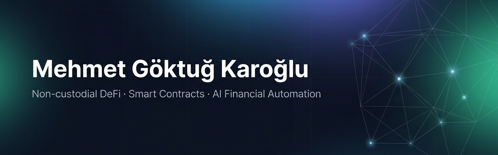

Engineering non-custodial DeFi primitives, security-audited smart contracts, and AI-powered financial automation.

Most of my public work lives at the intersection of **Web3 infrastructure** (Stellar/Soroban, Base/EVM) and **agentic tooling** (TypeScript, Python).

---

### Open-Source Projects

Start with **`portus`** if you are looking at institutional Web3 treasury architecture, or **`polymarket-agent`** if you are exploring AI + on-chain markets.

| Project | What it does | Who it is for | Status |
|---|---|---|---|
| [**portus**](https://github.com/AzrielTheHellrazor/portus) | Institutional multi-currency corporate treasury on Stellar | Fintech & Stellar builders | Active |
| [**grid-surgeon-okx-team1**](https://github.com/AzrielTheHellrazor/grid-surgeon-okx-team1) | Grid trading & execution tooling for OKX workflows | Quant & algo traders | Active |
| [**polymarket-agent**](https://github.com/AzrielTheHellrazor/polymarket-agent) | AI-driven market analysis and automation for Polymarket | AI & prediction market devs | Experimental |
| [**retro-base-contracts**](https://github.com/AzrielTheHellrazor/retro-base-contracts) | Solidity smart contracts built for Base | EVM / Solidity developers | Reference |
| [**nomad-radar-bot**](https://github.com/AzrielTheHellrazor/nomad-radar-bot) | Holiday & dual-mode budget travel deal Telegram bot | Turkish travelers & bot devs | Maintained |
| [**Asyar-language-extension**](https://github.com/AzrielTheHellrazor/Asyar-language-extension) | Trilingual (DE/EN/TR) dictionary & German trainer for Asyar | Language learners & extension devs | Maintained |

---

### Core Stack

- **Smart Contracts & Security:** Rust (`#![no_std]` / Soroban), Solidity (Base / EVM, Foundry, Hardhat), Clarity
- **Backend & AI Agents:** TypeScript / Bun (Next.js, Svelte, MCP / Agent SDKs), Python 3.12+ (`httpx`, SQLite, LLM APIs)
- **Focus:** Yield tokenization, institutional treasury flows, DeFi invariant verification, and agentic financial systems

---

### How to Contribute & What Is Not Here

- **Contributions welcome:** Issues and PRs are open on `portus`, `nomad-radar-bot`, and `Asyar-language-extension`.
- **Scope note:** Security audit PoCs and private client/research repositories are kept private and are not mirrored here. *"Include private contributions"* on my graph reflects active private engineering alongside public releases.

---

### Next Step

**Explore the flagship codebase:** [**github.com/AzrielTheHellrazor/portus**](https://github.com/AzrielTheHellrazor/portus)

Elsewhere: [LinkedIn](https://www.linkedin.com/in/mehmet-goktug-karoglu/) · [All Repositories](https://github.com/AzrielTheHellrazor?tab=repositories)

<!-- profile-owner: AzrielTheHellrazor | last-reviewed: 2026-11-14 | review-triggers: major release, new flagship repo, hackathon/grant launch -->
